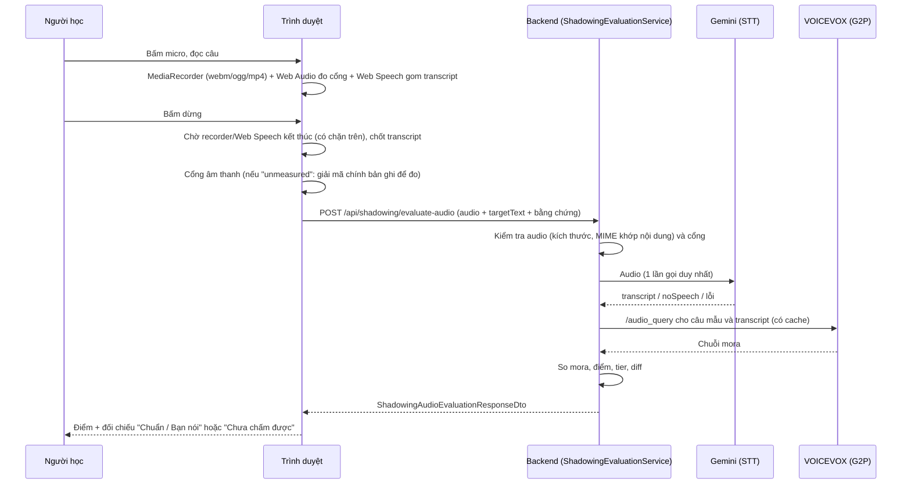

# Shadowing: nhận diện giọng nói và chấm điểm

Tài liệu mô tả **toàn bộ logic hiện tại** (scoring version `shadowing-score/p2-content-word`, so khớp `kana-word-v1`).
Mọi chi tiết dưới đây khớp với mã nguồn; mỗi mục có chỉ dẫn file để đối chiếu.

> **Chế độ nhận dạng hiện tại: trình duyệt (`Shadowing:Recognition:Provider` = `browser`, mặc định).** Backend **không gọi Gemini**,
> chỉ chấm theo transcript Web Speech đã chốt (`final`) do client gửi; audio không được dùng nên bỏ qua kiểm tra dung lượng/MIME
> (cổng âm thanh `needs_retry` vẫn chặn). Không có transcript hợp lệ → `unavailable` (`NO_SPEECH_DETECTED`, `BROWSER_STT_UNSUPPORTED`,
> `BROWSER_STT_ERROR`), không bao giờ là điểm 0. Đặt `Provider` = `gemini` để bật lại luồng Gemini mô tả bên dưới (mục 3, 5.2–5.4).

> **Nhịp nói (Fluency, số liệu thô, `fluency-metrics/v1`).** Sau khi chấm nội dung, client gửi thêm `analysisWav` (WAV PCM 16-bit mono 16 kHz,
> được render lại qua `OfflineAudioContext` nên đúng tần số; `jcap-web/src/utils/wavEncoder.ts`). Backend (`FluencyAnalyzer`, C#, không cần Python/ffmpeg)
> chạy VAD theo năng lượng (khung 20 ms, ngưỡng thích nghi, hysteresis) và trả `fluency`: thời gian nói, tỷ lệ nói, số/độ dài khoảng dừng (≥ 250 ms),
> tốc độ mora/giây (số mora lấy từ cách đọc câu mẫu). **Không phải điểm, không nói lên phát âm đúng/sai, không tính vào Overall**;
> `fluencyScore` vẫn `null`. Ngưỡng là heuristic chưa hiệu chuẩn. Không đo được thì `status = unavailable` kèm `reasonCode`
> (NO_SIGNAL, LOW_LEVEL, NOISE_ONLY, AUDIO_TOO_SHORT, SPEECH_TOO_SHORT, INVALID_WAV, UNSUPPORTED_WAV_FORMAT, ANALYSIS_ERROR); lỗi ở phần này không bao giờ làm mất điểm nội dung.
>
> ### So nhịp nói với giọng mẫu (`fluency.reference` / `comparison` / `observations`)
> **Điều kiện** (`FluencyComparer.CheckEligibility`; thiếu một điều kiện thì `comparison.status = unavailable` kèm `reasonCode`, không tạo nhận xét, không phải nói tốt hay kém):
> kết quả nội dung là `completed` (không phải `partial`/dự phòng); Content Match ≥ `MinContentMatch` (70); số mora của transcript / số mora câu mẫu nằm trong [0.8, 1.25]
> (điểm cao chưa chắc transcript tương ứng câu mẫu nên có thêm kiểm tra này); bản ghi người học đo được; có giọng mẫu phân tích được; đoạn nói cả hai phía ≥ 800 ms.
> `reasonCode`: TRANSCRIPT_NOT_RELIABLE, CONTENT_BELOW_THRESHOLD, TRANSCRIPT_MORA_MISMATCH, LEARNER_UNAVAILABLE, REFERENCE_UNAVAILABLE, SPEECH_TOO_SHORT_FOR_COMPARISON.
> Khi chưa đủ điều kiện, backend không tính mora/giây (tránh con số vô nghĩa khi người học đọc câu khác); giao diện ẩn cả khối nhịp nói.
>
> **Giọng mẫu:** backend tự tạo bằng VOICEVOX `/synthesis` qua `VoiceVoxService` (cache RAM + đĩa; thường người học vừa nghe nên đã có sẵn), đúng giọng người học chọn (`referenceSpeakerId`, thiếu thì dùng
> `Shadowing:Fluency:ReferenceSpeaker` → `Shadowing:Reading:Speaker`). Không tin dữ liệu mẫu do client gửi; không lưu audio/transcript mới. Câu > 300 ký tự không tạo giọng mẫu.
> Nếu người học nghe `nativeAudioUrl` của admin (hiện hầu hết là null) thì giọng mẫu dùng để so vẫn là VOICEVOX, có thể lệch nhịp.
>
> **Định nghĩa chỉ số** (cùng một VAD và tiêu chí cho cả hai phía; im lặng đầu/cuối bị loại): khoảng nói = từ đầu đoạn tiếng nói đầu đến hết đoạn cuối; khoảng dừng = khoảng lặng ≥ 250 ms **giữa** hai đoạn;
> khoảng lặng < 120 ms (khoảng đóng âm tắc, っ) được lấp. Tốc độ trong thời gian có tiếng nói (articulation) = mora / (khoảng nói − tổng dừng); tốc độ toàn câu (speaking) = mora / khoảng nói.
> Số mora luôn đếm từ **câu mẫu**, transcript chỉ dùng để kiểm tra tương ứng. `articulationRateRatio` = tốc độ người học / giọng mẫu (hai bên cùng câu nên bằng tỷ lệ nghịch của thời lượng nói).
>
> **Nhận xét** (tối đa `MaxObservations` = 3; mỗi nhận xét có `code`, `measuredValue`, `threshold`, `data`, `message` tiếng Việt):
> `slow_vs_reference` khi ratio ≤ 0.70; `fast_vs_reference` khi ratio ≥ 1.40; `extra_pause` khi có khoảng dừng ≥ 400 ms mà giọng mẫu không dừng ở vị trí tương ứng
> (vị trí chuẩn hóa theo độ dài đoạn nói, dung sai 0.12). Khoảng dừng ở **1/3 đầu** (người học cần thời gian chuẩn bị) và **1/3 cuối** câu (dừng cuối câu là bình thường) không bị báo khi ratio trong [0.6, 1.6]; chỉ khoảng dừng ở giữa câu mới có nhận xét.
> **Vị trí theo từ** (`PausePositionLocator`): cắt bản ghi người học tới lúc bắt đầu khoảng dừng, căn chỉnh phần đó với phần đầu của giọng mẫu VOICEVOX bằng DTW đầu-mở,
> tra mốc mora của engine để biết người học đã đọc xong bao nhiêu mora, rồi gióng với ranh giới từ của câu mẫu →
> "Bạn dừng 2.7 giây sau 「棚に」, trước 「入れても」…" (hoặc "ngay giữa từ 「…」" nếu cách xa ranh giới hơn 1 mora; trợ từ đơn được ghép với từ đứng trước).
> Đặc trưng căn chỉnh là **log-năng lượng 4 dải tần** (loại âm), KHÔNG dùng MFCC: MFCC phụ thuộc âm sắc người nói nên với giọng nam (khác giọng mẫu) lệch 2–4 mora và bị chặn bởi ngưỡng tin cậy.
> Đo thật (VOICEVOX, dừng 2.5 giây, 22 ca mỗi giọng): giọng nữ 20/22 ca lệch không quá ±1 mora (13 ca đúng mora); giọng nam 20/22 và 17/22; có ồn SNR 15 dB: 17/20 ca (2 ca bị từ chối). Có ca lệch 2–3 mora.
> Vì vậy tên từ là **ước lượng, sai số thường ±1 mora** (có thể nêu từ kề bên khi từ đó chỉ 1 mora, vd. を). Giọng người thật chưa được kiểm chứng. Căn chỉnh không đủ tin cậy (thiếu mốc mora, số mora lệch,
> chi phí căn chỉnh > `Shadowing:Pause:MaxAlignmentCost`, mặc định 2.5) thì quay về nói chung "ở khoảng giữa câu", KHÔNG đoán từ. Lý do được ghi trong `data.placementFailure` / `data.placementCost` của nhận xét và trong log backend.
> **Nhiều khoảng dừng thừa**: gộp trong MỘT nhận xét `extra_pause`, theo thứ tự thời gian, mỗi khoảng có độ dài và vị trí riêng, ví dụ
> "Bạn dừng thừa 2 lần mà giọng mẫu không dừng ở đó: 1.1 giây sau 「荷物を」, trước 「上の棚」; 2.7 giây sau 「棚に」, trước 「入れても」. Hãy thử đọc liền hơn."
> Tối đa 3 khoảng được nêu (lấy 3 khoảng dài nhất), phần còn lại ghi "(và N chỗ khác)"; khoảng nào chưa định vị được thì chỉ nêu độ dài. `data.pauses` giữ toàn bộ, `data.placements` giữ kết quả định vị từng khoảng.
> Nhận xét `extra_pause` cùng tồn tại với `slow_vs_reference`/`fast_vs_reference` và nhận xét trường âm; tổng không quá `MaxObservations` (mặc định 3).
> Khi trục thời gian lệch (ratio ngoài [0.6, 1.6]) thì chỉ nói có dừng thừa.
> Chênh lệch nhỏ thì không nhận xét. Ngưỡng cấu hình qua `Shadowing:Fluency:Comparison:*` (SlowRatio, FastRatio, ExtraPauseMinMs, MinContentMatch, ...). Tất cả là heuristic chưa hiệu chuẩn trên giọng người thật.
> `fluencyScore` vẫn `null`; không thêm điểm phát âm; Content Match không đổi.
>
> ### Đo thời lượng trường âm so với giọng mẫu (`fluency.duration`, THỬ NGHIỆM, `mora-duration/v0-experimental`)
> Chỉ chạy khi đã đủ điều kiện so nhịp nói (xem trên) và có giọng mẫu cùng mốc mora. Có thể tắt: `Shadowing:Duration:Enabled=false`.
> **Cách làm:** (1) mốc từng mora của giọng mẫu lấy từ VOICEVOX `audio_query` (`VoiceVoxService.GetMoraTimelineAsync`, cache theo giọng+văn bản), co giãn cho khớp khoảng nói thật của audio mẫu
> (lệch quá ±15% thì bỏ: `TIMELINE_MISMATCH`); mốc là ước lượng của engine, lệch −3%…+4% so với audio thật; (2) MFCC 13 hệ số + 13 delta (CMVN theo từng bản ghi, `SpeechFeatures`) trên phần đã cắt khoảng lặng;
> (3) DTW có ràng buộc độ dốc (mỗi bước tối đa 1:3, dải Sakoe-Chiba, `Dtw`) giữa giọng mẫu và giọng người học; (4) chiếu mốc mora sang người học để có thời lượng từng mora;
> (5) với mỗi đoạn trường âm (nguyên âm của mora mang nó + mora `ー` liền sau): `RelativeRatio = (thời lượng người học / mẫu) / tốc độ chung`, tốc độ chung = trung vị tỷ lệ của các mora thường.
> `RelativeRatio ≤ ShortRatio (0.55)` thì nhận xét `chouon_short` (tối đa 2, đứng trước nhận xét nhịp chung; có nhãn "Thử nghiệm", `data.experimental = true`).
> **Lọc độ tin cậy:** khoảng cách MFCC trung bình trên đường căn chỉnh ≤ `MaxAlignmentCost` (5.5) và độ phân tán tốc độ ≤ `MaxTempoSpread` (0.4); vượt thì `ALIGNMENT_UNRELIABLE`: vẫn trả số đo để chẩn đoán nhưng không gắn cờ.
> Mã `reasonCode`: TIMELINE_UNAVAILABLE, TIMELINE_MISMATCH, NO_LONG_VOWEL, LEARNER_UNAVAILABLE, REFERENCE_UNAVAILABLE, ALIGNMENT_FAILED, ALIGNMENT_UNRELIABLE, ANALYSIS_ERROR.
>
> **Kiểm chứng (giọng VOICEVOX, KHÔNG phải người thật).** Giọng mẫu là ずんだもん; "người học" là 6 nhân vật khác (nam/nữ, khác âm sắc) × 2 tốc độ (x1.0, x1.3) × 7 cặp từ chỉ khác nhau ở trường âm
> (おばあさん/おばさん, おじいさん/おじさん, ありがとうございます/ありがとございます, おねえさん/おねさん, こうえん/こえん, ゆうめい/ゆめい, おおきい/おきい). Cấu hình mặc định:
>
> | Ca thử (n=84 mỗi loại) | Kết quả |
> |---|---|
> | Đọc đúng trường âm | không báo 66, **báo nhầm 1**, không đủ điều kiện 17 |
> | Đọc ngắn trường âm | **phát hiện 29**, bỏ sót 33, không đủ điều kiện 22 |
> | Đọc câu khác hẳn | báo lỗi 0, không đủ điều kiện 78, không báo 6 |
>
> Tức là ưu tiên **không báo nhầm** hơn bắt hết: chỉ phát hiện khoảng 35% (47% trong số ca đủ điều kiện) lỗi trường âm bị bỏ.
> Quá trình chọn: DTW không ràng buộc độ dốc cho 70% phát hiện nhưng 26% báo nhầm; ràng buộc độ dốc và thêm đặc trưng delta đưa báo nhầm xuống ~1% (ngưỡng 0.55); cách đo "độ dài nguyên âm ổn định" và tốc độ cục bộ không tốt hơn nên bỏ.
> **Giới hạn:** chưa thử trên giọng người học thật và micro thật (giọng người dao động nhiều hơn giọng tổng hợp nên tỷ lệ báo nhầm ngoài thực tế có thể cao hơn); chỉ đo trường âm, không đo っ, âm vị hay ngữ điệu;
> không nêu tên từ, chỉ nêu kana của đoạn đo (vd. 「ばあ」); mốc mora của giọng mẫu là ước lượng của engine; nếu người học nghe `nativeAudioUrl` thì giọng mẫu vẫn là VOICEVOX.

## 1. Tóm tắt

Người học đọc một câu → trình duyệt ghi âm và đo chất lượng tín hiệu → **Gemini nghe audio và chép lại thành chữ (transcript)** →
backend đổi câu mẫu và transcript thành **chuỗi mora (cách đọc)** bằng **VOICEVOX G2P** → so từng mora → ra điểm.

Ba điều cần nhớ:

1. **Backend là nơi duy nhất tính điểm.** Frontend chỉ thu bằng chứng và hiển thị kết quả.
2. **Điểm là Content Match theo transcript, không phải điểm phát âm âm học.** Lưu loát và ngữ điệu chưa được đo (hiển thị "Chưa đo").
3. **Thiếu dữ liệu thì không chấm, không đoán.** Không nghe được, không có cách đọc, hoặc lỗi kỹ thuật đều ra trạng thái "chưa chấm được", không bao giờ thành điểm 0.

## 2. Ai làm gì

| Thành phần | Việc làm | Việc KHÔNG làm |
|---|---|---|
| **Trình duyệt** (MediaRecorder, Web Audio, Web Speech) | Ghi âm; đo cổng âm thanh; gom transcript Web Speech đã chốt (dự phòng) | Không tính điểm |
| **Gemini** (`GeminiSpeechRecognizer`) | Nghe audio, trả transcript. Không biết câu mẫu | Không chấm, không nhận xét |
| **VOICEVOX** (`VoiceVoxKanaReader`) | Nhận **văn bản**, trả cách đọc (mora). Chỉ dùng endpoint `/audio_query` | Không nhận audio, không nghe giọng, không chấm |
| **`KanaMoraComparer`** | So chuỗi mora câu mẫu và transcript, tính điểm, phân loại lỗi | Không gọi dịch vụ ngoài trực tiếp |
| **`ShadowingEvaluationService`** | Điều phối các bước, chính sách nguồn nhận dạng, tạo response | |
| **`ShadowingScoring`** | Công thức Overall và ngưỡng tier (duy nhất) | |

## 3. Luồng đầu-cuối

## 4. Phía trình duyệt

File chính: `jcap-web/src/views/shadowing/LearnerShadowingPracticeView.tsx` (`startRecording`, `startRecognitionSession`, `stopRecordingManually`, `applyBackendEvaluation`, `showNotScored`).

### 4.1 Ghi âm
- `getUserMedia` với `echoCancellation`, `noiseSuppression`, `autoGainControl` bật, mono, 48 kHz (chọn thiết bị nếu có).
- **MIME thật** được chọn theo thứ tự `audio/webm;codecs=opus` → `audio/webm` → `audio/ogg;codecs=opus` → `audio/mp4` (`utils/recordingMime.ts`),
  lấy loại đầu tiên mà `MediaRecorder.isTypeSupported` cho phép. Blob mang đúng MIME mà recorder báo; nếu không xác định được thì để rỗng
  (backend sẽ từ chối), **không** mặc định `audio/webm`.
- `MediaRecorder.start(100)`: cắt dữ liệu mỗi 100 ms.

### 4.2 Web Speech API (nguồn dự phòng, `utils/speechTranscriptCollector.ts`)
- `ja-JP`, `continuous = true`, `interimResults = true`.
- Trình duyệt tự kết thúc phiên (`onend`) thì tự khởi động lại, tối đa 5 lần, **trừ khi** đã bấm dừng hoặc gặp lỗi nghiêm trọng
  (`not-allowed`, `service-not-allowed`, `audio-capture`, `language-not-supported`).
- Mỗi phiên là một session riêng. `event.results` của phiên mới bắt đầu lại từ 0, nên collector **giữ lại các đoạn đã chốt** của phiên cũ.
- Kết quả **interim chỉ để hiển thị trực tiếp**; transcript dùng để chấm chỉ gồm đoạn `isFinal`.
- Mỗi lần nhận kết quả thay thế nguyên snapshot của phiên (không nối thêm) nên sự kiện lặp không nhân đôi chữ. Sự kiện của phiên cũ đến muộn bị bỏ qua.
- `no-speech` và `aborted` không bị coi là lỗi. Trạng thái cuối: `final | empty | unsupported | error`.

### 4.3 Khi bấm dừng
1. `collector.requestStop()`, `recognition.stop()`, `recorder.stop()`; giao diện sang trạng thái "đang phân tích".
2. **Chờ theo sự kiện, có chặn trên:** recorder `onstop` (tối đa 2000 ms) và Web Speech `onend` (tối đa 600 ms, vì Web Speech chỉ là dự phòng). Không dùng độ trễ cố định.
3. `collector.lock()`: từ đây mọi sự kiện đến muộn không ghi đè kết quả. Bấm thử lại/đi tiếp/đổi vai sẽ vô hiệu hóa kết quả đang chờ (`evaluationSeqRef`).
4. Không có dữ liệu audio → "chưa chấm được" ngay (không gọi backend).

### 4.4 Cổng âm thanh (`utils/audioGate.ts`, `services/audioMetricsService.ts`)
Heuristic ngưỡng cố định, **chưa hiệu chuẩn**; chỉ để chặn bản thu rõ ràng không dùng được, không tạo điểm.
Dựa trên RMS theo khung ~60 khung/giây:

| Điều kiện (kiểm tra theo thứ tự) | Kết quả |
|---|---|
| Không có khung nào, hoặc RMS lớn nhất < 0.003 (im lặng) | `needs_retry` |
| Thời lượng < 400 ms (thông báo "Bản ghi quá ngắn (x.x giây)") | `needs_retry` |
| RMS giọng < 0.008 ≈ −42 dB (thông báo "Âm lượng mic quá nhỏ (đo được N dB, cần từ −42 dB)") | `needs_retry` |
| Số khung vỡ tiếng > 30% tổng khung | `needs_retry` |
| SNR < 6 dB | `needs_retry` |
| SNR < 12 dB, hoặc RMS giọng < 0.025, hoặc khung vỡ tiếng > 15 | `acceptable` |
| Còn lại | `good` |

SNR = 20·log10(RMS giọng / nền ồn); RMS giọng = trung vị RMS của các khung đang có tiếng (khung ≥ 25% mức phân vị 95), nên không phụ thuộc độ dài bản ghi (cách cũ lấy trung bình nửa khung to nhất làm bản ghi dài mà nói ít bị chặn nhầm); nền ồn = trung bình 15% khung nhỏ nhất (tối thiểu 0.001).

**Bộ đo trực tiếp không đo được** (ví dụ im lặng số làm mọi mẫu bằng 0, hoặc không có AudioContext) → trạng thái `unmeasured`.
Khi đó client **giải mã chính bản ghi** (`measureRecordedBlob`, `decodeAudioData`) rồi áp cùng bộ quy tắc. Chỉ khi giải mã cũng thất bại mới gửi `unmeasured`.
`unmeasured` không bao giờ được coi là `good`.

**Vì sao cổng là bắt buộc:** thử với Gemini thật cho thấy với im lặng tuyệt đối nó vẫn bịa chữ ("お腹が空きました", "日本語", "こんにちは"),
kèm `confidence` cao. Prompt chặt hơn chỉ chặn được trường hợp chỉ có tiếng ồn. Vì vậy bản thu không có tiếng phải bị chặn trước khi tới nhận dạng.

### 4.5 Gửi lên backend (`services/shadowingService.ts › evaluateAudio`)
`multipart/form-data`: `audio` (tên tệp theo MIME), `targetText`, `audioGateStatus`, `audioGateDetail`, `durationMs`,
`clientRecognitionStatus`, `clientRecognitionError`, và `clientTranscript` **chỉ khi** trạng thái là `final`.
HTTP 401 / 429 / lỗi khác / mất kết nối → `failed` với thông báo, **không có điểm**.

## 5. Phía backend

### 5.1 Controller (`Controllers/ShadowingController.cs`)
`POST /api/shadowing/evaluate-audio`: yêu cầu JWT; body ≤ 6 MB; tối đa 30 lượt/phút/người dùng. `targetText` rỗng → 400.
Audio rỗng → `unavailable / EMPTY_AUDIO`. Ngoại lệ → `failed / EVALUATION_EXCEPTION` (không trả `ex.Message`).

### 5.2 Điều phối (`Services/Implementations/ShadowingEvaluationService.cs`)
Thứ tự và mã kết quả:

| # | Bước | Điều kiện dừng | Kết quả |
|---|---|---|---|
| 1 | Câu mẫu | rỗng | `unavailable / MISSING_TARGET_TEXT` |
| 2 | Kiểm tra audio | < 800 byte | `unavailable / AUDIO_TOO_SHORT` |
| | | > `Shadowing:Audio:MaxBytes` (5 MB) | `unavailable / AUDIO_TOO_LARGE` |
| | | MIME không hỗ trợ | `unavailable / UNSUPPORTED_AUDIO_TYPE` |
| | | MIME khai báo không khớp nội dung (đọc vài byte đầu) | `unavailable / AUDIO_FORMAT_MISMATCH` |
| 3 | Cổng âm thanh | `needs_retry` | `unavailable / AUDIO_QUALITY_INSUFFICIENT` (không gọi Gemini) |
| 4 | Nhận dạng | xem 5.3 | |
| 5 | Cách đọc + so khớp | không đọc được | `failed / READING_UNAVAILABLE` |
| 6 | Chấm điểm | | `completed` hoặc `partial` |

Họ định dạng được nhận: webm, ogg, mp4, wav, mp3, flac, aac (`AudioFormatSniffer`).

### 5.3 Chính sách nguồn nhận dạng (chế độ `gemini`)
Ở chế độ `gemini`, Gemini là nguồn chính, gọi **đúng một lần** cho mỗi lượt (`GeminiSpeechRecognizer`). Chế độ mặc định (`browser`) xem phần đầu tài liệu.

| Kết quả từ Gemini | Hành động |
|---|---|
| Nhận dạng được | Dùng transcript Gemini. `completed`, `recognitionSource=gemini` |
| Báo không có tiếng nói | `unavailable / NO_SPEECH_DETECTED`, `recognitionStatus=no_speech`. **Không đổi nguồn** |
| **Lỗi kỹ thuật** (chưa cấu hình, timeout, quota, lỗi nhà cung cấp, phản hồi hỏng) **và** client có transcript đã chốt | Dùng transcript Web Speech: `partial`, `recognitionSource=web_speech`, `fallbackReason=<mã lỗi Gemini>` |
| Lỗi kỹ thuật, không có transcript hợp lệ | `failed` với mã lỗi của Gemini |

Transcript Web Speech chỉ được chấp nhận khi `clientRecognitionStatus = final`, không rỗng sau chuẩn hóa, cắt tối đa 500 ký tự. **Không bao giờ dùng interim.**
Điểm 0 hợp lệ (nói sai hoàn toàn) là `completed` và **không bao giờ** kích hoạt đổi nguồn. Hai nguồn không bao giờ trộn điểm.
Cùng transcript cuối cùng + cùng version ⇒ cùng điểm, bất kể nguồn hay tốc độ mạng.

### 5.4 Gemini (`GeminiSpeechRecognizer.cs`)
- Model: `Gemini:AudioModel` → `Gemini:Model` → `gemini-3.1-flash-lite`. API key đi trong header `x-goog-api-key`, không nằm trong URL.
- Gửi audio inline (base64) kèm system prompt và `temperature = 0`, `responseMimeType = application/json`. **Không gửi câu mẫu.**
- Prompt: chỉ báo lời nói nghe rõ (im lặng/ồn/tiếng thở không phải lời nói; không bịa); chép nguyên văn, không sửa ngữ pháp,
  không hoàn thiện âm bị thiếu hay phát âm sai. Trả JSON `{noSpeech, transcript}`.
- Timeout `Shadowing:Recognition:GeminiTimeoutSeconds` (mặc định 15). **Nếu client đã gửi kèm transcript Web Speech đã chốt** (có dự phòng), backend chỉ chờ
  `Shadowing:Recognition:GeminiTimeoutWithFallbackSeconds` (mặc định 8) rồi chuyển sang dự phòng; không có dự phòng thì chờ đủ 15 giây. Lý do: độ trễ Gemini có đuôi dài
  (đo thực: thường 1.5–2.5 s nhưng có lượt 9–15 s). Hủy do người gọi được ném lên, không bị coi là timeout.
- Mã lỗi: `AI_KEY_NOT_CONFIGURED`, `AI_TIMEOUT`, `AI_QUOTA_EXCEEDED` (HTTP 429), `AI_HTTP_<mã>`, `AI_NETWORK_ERROR`, `AI_EMPTY_CANDIDATES` / `AI_EMPTY_PARTS` / `AI_EMPTY_TEXT` / `AI_MALFORMED_RESPONSE`.

### 5.5 Cách đọc (`VoiceVoxKanaReader.cs`)
- `POST {VoiceVox:BaseUrl}/audio_query?text=<văn bản>&speaker=<id>`; lấy `accent_phrases[].moras[].text`, bỏ `pause_mora`. Chỉ nhận **văn bản**.
- Cache theo văn bản (tối đa 5000 mục); timeout `Shadowing:Reading:TimeoutMs` (10000 ms). Hai phía được đọc **song song**, và cách đọc câu mẫu được **làm nóng trước** ngay khi bắt đầu gọi Gemini (các yêu cầu cùng văn bản được gộp thành một lần gọi engine).
  Chỉ **lỗi kết nối** mới **ngắt mạch 60 giây** (các lượt sau trả không-dùng-được ngay, không chờ); quá thời gian chờ chỉ làm lượt đó không chấm được.
  Engine dùng riêng được cấu hình bằng `Shadowing:Reading:BaseUrl` (mặc định = `VoiceVox:BaseUrl`).
- Đây là nguồn **duy nhất**. Không có bảng tra dự phòng và không đoán cách đọc (bảng từ điển offline từng có đã bị bỏ).
- Hai phía (câu mẫu và transcript) luôn dùng cùng nguồn. Nếu không đọc được một phía, hoặc có ký tự không đổi được sang kana → `READING_UNAVAILABLE`:
  **không có điểm**, `recognizedText` vẫn được trả, lượt đó không bị tính vào điểm buổi.

### 5.6 So khớp theo TỪ (`KanaMoraComparer.cs`, `JapaneseMora.cs`, `JapaneseSurfaceAligner.cs`)

Điểm được tính **theo từ, không theo ký tự/mora rời rạc**: một từ chỉ được tính khi người học đọc đúng **toàn bộ** từ đó.
Mora trùng ngẫu nhiên bên trong một từ sai **không** được tính điểm. Ví dụ câu mẫu có 4 từ, 14 mora; người học không đọc đúng từ nào nhưng 10/14 mora trùng ⇒ **0 điểm** (chấm theo mora sẽ ra ~71).

**Từ là gì.** Mỗi *cụm trọng âm* (accent phrase) mà VOICEVOX trả về là một từ cùng các trợ từ/đuôi gắn liền (`助かります`, `いつでも`, `頼んでも`). Ngoài ra trợ từ đơn đứng cuối sau
**chữ Hán hoặc katakana** (`を は が に へ で と も の や`) được tách thành từ riêng, để lỗi trợ từ không làm sai cả từ chính (`飲み物` + `を`). Nguồn cách đọc không cung cấp ranh giới từ thì cả câu là một từ.
Giới hạn: đơn vị là cụm trọng âm, không phải từ điển học thuật; trợ từ đứng sau hiragana (`おばあさんが`) vẫn dính vào từ trước.

**Chuẩn hóa mora** (so sánh theo cách PHÁT ÂM, thực hiện **trong từng từ**; ranh giới từ làm mới ngữ cảnh nên một từ đọc đúng luôn có cùng chuỗi mora bất kể từ đứng trước):

- NFKC, bỏ khoảng trắng và dấu câu (giữ `ー`); katakana → hiragana.
- `ゃゅょ` và `ぁぃぅぇぉ` nhỏ ghép với kana trước (しゃ = 1 mora). `っ` và `ん` mỗi cái là một mora riêng.
- **Trường âm là một mora riêng `ー`**, dù viết là `ー`, nguyên âm lặp lại (おかあさん, ええ), お段+う (おとうさん, がっこう) hay え段+い (きれい, せんせい).
  Nguyên âm sau `っ`, `ん` hoặc kana chưa phân giải thì không bị coi là trường âm.
- `を→お`, `ぢ→じ`, `づ→ず`.

**Căn chỉnh và điểm:**

1. Khoảng cách chỉnh sửa trên mora (thay / thiếu / thừa) để biết mora nào đúng. Khi nhiều cách căn chỉnh cùng số lỗi, ưu tiên đặt âm thừa ở **ranh giới giữa các từ** (không chen vào giữa một từ).
2. Mỗi từ được đánh giá: **đúng** nếu mọi mora đúng và không có âm thừa chen giữa; **thiếu** nếu mọi mora bị bỏ; còn lại **sai**.
3. `Điểm = 100 × (số mora của các từ đúng − số mora thừa đứng riêng) / số mora câu mẫu`, tối thiểu 0, làm tròn ra xa số 0; tối đa 99 nếu chưa hoàn hảo, 100 khi mọi từ đúng và không có âm thừa.
   Âm thừa nằm **trong** một từ sai không bị trừ thêm (từ đó đã không được tính).
4. Với từ sai, phân loại lỗi mora đầu tiên để nhận xét: `chouon`, `sokuon`, `hatsuon`, `voicing` (đục/trong: k↔g, s↔z, t↔d, h↔b↔p), `mora`, `extra`.
5. **Hiển thị theo từ trên CÂU MẪU GỐC**: mỗi từ một token (đúng / thiếu / sai), các từ đúng liền kề được gộp, âm thừa đứng riêng là token `extra` (hiển thị đúng chữ viết của transcript).
   Chữ viết được gióng với mora bằng `JapaneseSurfaceAligner` (kana khớp đúng một mora; cụm chữ Hán nhận một hoặc nhiều mora, okurigana là mỏ neo; dấu câu không chiếm mora; `は→わ`, `へ→え`;
   nguyên âm lặp lại nguyên âm trước như `を` sau `の`, `いい`, `おう` khớp với trường âm). Token chưa đúng mang `expectedReading` và `spokenPart` làm chú thích.
   Không gióng được chữ viết với cách đọc thì dự phòng hiển thị từng từ bằng kana.
6. Nhận xét tiếng Việt nêu tối đa 3 từ chưa đúng (đọc chuẩn là gì, bạn nói gì, kiểu lỗi) và âm thừa.

Ví dụ (đo với VOICEVOX thật): `いいです、いつでもどうぞ。おねがいします。` nói thành `ですね。いつよりもどうぞお願いします。` → **50** (trước đây chấm theo mora là 67): `いいです` và `いつでも` sai nguyên từ, `ね` thừa;
`助かります。飲み物を頼んでもいいですか。` → 48; `綺麗ですね` = `きれいですね` → 100; `東京へ行きました` = `とうきょうへいきました` → 100.

### 5.7 Điểm và tier (`ShadowingScoring.cs`)
- Chỉ **Content Match** được đo. `fluencyScore`, `pronunciationScore` luôn `null`, nằm trong `unavailableDimensions`.
- `Overall` = trung bình có trọng số (Content 0.6, Fluency 0.4) của các chiều đã đo; chia lại trọng số khi một chiều là `null` ⇒ hiện tại **`Overall = Content Match`**.
- Tier: `green` ≥ 80, `yellow` ≥ 65, còn lại `red`. Vì chấm theo từ nên điểm có tính "bậc thang" hơn: một từ dài sai làm mất nguyên từ đó, nên câu ngắn dễ xuống `yellow`/`red` hơn so với chấm theo mora.

## 6. Hiển thị

| Kết quả backend | Giao diện |
|---|---|
| `completed` / `partial` | Thẻ điểm; câu mẫu gốc với chữ sai được tô, rê chuột để xem "Câu mẫu: 助 (たす) ➔ Bạn nói: かし"; dòng "Bạn đã nói" (transcript). `partial` + `web_speech` có ghi chú đã chấm theo nhận dạng của trình duyệt |
| `unavailable` | "Chưa thể đánh giá bản ghi" kèm lý do (im lặng, không nghe rõ, âm thanh không đạt…) |
| `failed` | "Chưa thể chấm điểm lúc này" kèm lý do (timeout, quota, `READING_UNAVAILABLE`…) |
| `fluencyScore`/`pronunciationScore` = null | "Chưa đo" (modal tổng kết, trang lịch sử, ô Ngữ điệu/Độ lưu loát) |

Câu chưa được chấm hiển thị "Chưa chấm" và "—", không bao giờ "0 điểm". Nhãn hạng chỉ nói về độ khớp ("Rất tốt", "Khá"), không nhắc lưu loát.

## 7. Kết thúc bài và lịch sử

- Client (`utils/shadowingSessionScores.ts`) tính điểm buổi để hiển thị ngay: **trung bình các điểm backend đã chấm trên tổng số câu của vai người học** (câu chưa luyện tính 0).
  Không áp lại công thức trọng số. Chỉ tính kết quả hợp lệ (`isValidForBestAttempt`).
- **Lưu kết quả từng câu:** client gửi `sentenceId` cùng bản ghi tới `evaluate-audio`. Backend lấy câu mẫu từ CSDL (bỏ qua `targetText` client gửi)
  và nếu câu được chấm (completed/partial) thì lưu `ShadowingSentenceEvaluation`, trả `evaluationId`. Lượt "chưa chấm được" không được lưu.
  Không có `sentenceId` thì vẫn chấm theo `targetText` nhưng không lưu (chỉ cho công cụ thử nghiệm).
- **Hoàn thành buổi:** `POST /api/shadowing/session/complete` chỉ nhận `dialogueId`, `learnerRole`, `durationSeconds`, `startedAt` và danh sách `evaluationIds`
  — **không nhận điểm**. `ShadowingService.CompleteSessionAsync` chỉ chấp nhận kết quả của chính người dùng, đúng bài, đúng vai và chưa thuộc buổi nào
  (gửi lại cùng Id không tạo được buổi thứ hai); nhiều lượt của một câu thì lấy lượt điểm cao nhất. Điểm tổng = trung bình trên tổng số câu của vai
  (câu chưa chấm tính 0) bằng `ShadowingScoring`, rồi lưu `ShadowingPracticeSession` (bất biến; ẩn bằng `IsActive = false`, không xóa cứng).
- **Lịch sử:** `GET /api/shadowing/history` trả tối đa 100 buổi gần nhất của người dùng, kèm từng câu (transcript, điểm, diff). Màn lịch sử ghép dữ liệu này
  với bản ghi CŨ còn trong localStorage (`shadowing_practice_history`, chỉ đọc) — `utils/shadowingHistory.ts` (`fromServerSession`, `mergeHistory`).
  Bản ghi cũ không có `scoringVersion` được gắn nhãn "Bản ghi cũ"; trường thiếu hiển thị "Chưa đo", không suy ra.
- Tiến trình đang luyện dở (để "luyện tiếp") và bookmark **vẫn lưu trong trình duyệt** (`shadowingStorageService`).

## 8. Cấu hình

| Khóa | Mặc định | Ghi chú |
|---|---|---|
| `Gemini:ApiKey` | — | Chưa cấu hình ⇒ lỗi kỹ thuật `AI_KEY_NOT_CONFIGURED` |
| `Gemini:AudioModel` → `Gemini:Model` | `gemini-3.1-flash-lite` | Trước đây mặc định `gemini-1.5-flash` (HTTP 404) nên mọi lượt rơi xuống Web Speech |
| `Shadowing:Recognition:GeminiTimeoutWithFallbackSeconds` | 8 | Dùng thay cho mục trên khi đã có transcript Web Speech dự phòng |
| `Shadowing:Recognition:GeminiTimeoutSeconds` | 15 | Đo thực 1.7–9.2 s, từng có lần chạm 10 s và 15 s |
| `Shadowing:Audio:MaxBytes` | 5242880 | |
| `VoiceVox:BaseUrl` | `http://127.0.0.1:50021` | Dùng chung với TTS |
| `Shadowing:Reading:UseVoiceVox` | `true` | `false`: mọi lượt là `READING_UNAVAILABLE` |
| `Shadowing:Reading:BaseUrl` | = `VoiceVox:BaseUrl` | **Nên trỏ tới một engine VOICEVOX RIÊNG** (cổng khác) chỉ để lấy cách đọc, tránh tranh với TTS |
| `Shadowing:Reading:TimeoutMs` / `Speaker` | 10000 / 1 | Chỉ lỗi kết nối mới ngắt mạch 60s |

## 9. Bảo mật

JWT bắt buộc (đã bỏ `[AllowAnonymous]`); giới hạn dung lượng và tần suất; MIME phải khớp nội dung; API key không nằm trong URL;
lỗi nhà cung cấp chỉ ghi trạng thái và thông điệp rút gọn (không ghi nội dung thô); không trả `ex.Message` cho client.

## 10. Giới hạn đã biết

- **Điểm là Content Match theo transcript.** Mô hình nhận dạng có thể "sửa" lỗi phát âm thành từ chuẩn: giọng tổng hợp đọc `がこう` mà Gemini vẫn trả `学校`,
  nên lỗi thiếu `っ` đó không bị phát hiện (còn thiếu trường âm `おばさん` thì bị phát hiện). Đo phát âm thật cần forced alignment hoặc so đường F0.
- **Im lặng tuyệt đối vẫn có thể bị Gemini bịa chữ** nếu bản thu lọt qua cổng (ví dụ cả đo trực tiếp lẫn giải mã đều thất bại và gửi `unmeasured`).
- **Cổng âm thanh là heuristic chưa hiệu chuẩn.** Kiểm trên giọng tổng hợp: SNR 0 dB vẫn "chấp nhận được" và Gemini nhận đúng; chưa thử với nhiều micro thật.
- **Độ trễ Gemini có đuôi dài** và có lúc trả 429/503. Khi đó người học nhận trạng thái "chưa chấm được" (hoặc `partial` nếu có transcript Web Speech).
- **Engine VOICEVOX xử lý tuần tự, TTS và lấy cách đọc tranh nhau.** Đo thực: `/audio_query` mất ~40 ms khi engine rảnh nhưng ~19 giây khi có 4 yêu cầu tổng hợp giọng đang chạy
  (màn luyện tập tải trước giọng mẫu cho các câu kế tiếp); với 3 câu tải trước, lượt chấm phải chờ khoảng 7 giây. Cách triệt để: chạy một engine riêng cho việc lấy cách đọc và đặt `Shadowing:Reading:BaseUrl`.
  (Trước khi sửa, timeout 1.5 giây khiến mọi lượt bị `READING_UNAVAILABLE` và ngắt mạch 60 giây ngay khi người học vào bài.)
- **Chấm điểm phụ thuộc engine VOICEVOX** (cách đọc). Engine tắt ⇒ không chấm được. G2P có thể đọc nhầm theo ngữ cảnh (ví dụ `十分かかります` đọc `じゅうぶん` thay vì `じゅっぷん`).
  Hướng giảm phụ thuộc: lưu cách đọc chuẩn của câu mẫu khi Admin tạo bài (cần thêm cột, phối hợp người phụ trách dữ liệu); phía transcript vẫn cần engine lúc chạy.
- **Transcript ở chế độ trình duyệt do client gửi lên.** Câu mẫu và điểm đã do backend quyết định, nhưng ở chế độ Web Speech (mặc định)
  transcript vẫn đến từ trình duyệt nên client có chủ ý gian lận vẫn gửi được transcript khớp tuyệt đối. Chế độ `gemini` không có điểm yếu này.
- **Chưa đo** lưu loát, ngữ điệu, pitch accent.
- Tính năng "Phân tích phát âm AI chuyên sâu" (15 credit) đã được **gỡ tạm thời**: bản cũ sinh điểm chi tiết bằng `Random` chứ không phân tích thật.
  Khi làm lại cần có nguồn đo thật (AiPronunciationDiagnostic) rồi mới thu credit.
- Chưa kiểm trên Safari/Firefox; Web Speech chưa được thử trong trình duyệt thật (Edge headless không trả kết quả), chỉ có test đơn vị.

## 11. Kiểm thử

- Backend: `dotnet test JCAP.Tests` (338 test; liên quan: `ShadowingEvaluationServiceTests`, `GeminiSpeechRecognizerTests`, `KanaMoraComparerTests`,
  `ShadowingScoringAndComparerTests`, `ShadowingServiceCompleteSessionTests`, `ShadowingControllerTests`, `FluencyAnalyzerTests`, `FluencyComparerTests`,
  `MoraDurationTests`, `PausePositionLocatorTests`; `SurfaceDiffTests` kiểm tra diff trên câu gốc).
  Test dùng `TestKanaReader` (bảng nhỏ **chỉ trong thư mục test**) thay cho VOICEVOX.
- Frontend: `npm test` (61 test: `speechTranscriptCollector`, `recordingMime`, `audioGate`, `wavEncoder`, `shadowingSessionScores`, `shadowingHistory`, `shadowingRoleUtils`) và `npm run build`.
- Đã kiểm chứng thủ công với Gemini, VOICEVOX và Edge thật (host thử đặt ngoài repo): đọc đúng, bỏ một mora, sai từ, im lặng, ồn, chỉ-có-ồn;
  timeout ép buộc; model cũ trả 404; VOICEVOX tắt; giao diện "Chưa đo".

## 12. Bản đồ file

| Việc | File |
|---|---|
| Ghi âm, Web Speech, gửi/nhận kết quả | `jcap-web/src/views/shadowing/LearnerShadowingPracticeView.tsx` |
| Gom transcript Web Speech | `jcap-web/src/utils/speechTranscriptCollector.ts` |
| Chọn MIME ghi âm | `jcap-web/src/utils/recordingMime.ts` |
| Cổng âm thanh | `jcap-web/src/utils/audioGate.ts`, `jcap-web/src/services/audioMetricsService.ts` |
| Gọi API chấm điểm | `jcap-web/src/services/shadowingService.ts` |
| Điểm buổi (hiển thị), ghép lịch sử | `jcap-web/src/utils/shadowingSessionScores.ts`, `shadowingHistory.ts` |
| Màn lịch sử | `jcap-web/src/views/shadowing/LearnerShadowingListView.tsx` |
| Controller | `Controllers/ShadowingController.cs` |
| Điều phối | `Services/Implementations/ShadowingEvaluationService.cs` |
| Nhận dạng Gemini | `Services/Implementations/GeminiSpeechRecognizer.cs` |
| Cách đọc VOICEVOX | `Services/Implementations/VoiceVoxKanaReader.cs` |
| Mora | `Services/Implementations/JapaneseMora.cs` |
| So khớp | `Services/Implementations/KanaMoraComparer.cs` |
| Gióng chữ viết với mora (diff trên câu gốc) | `Services/Implementations/JapaneseSurfaceAligner.cs` |
| Công thức điểm | `Services/Implementations/ShadowingScoring.cs` |
| Kiểm tra định dạng audio | `Services/Implementations/AudioFormatSniffer.cs` |
| Nhịp nói, khoảng dừng, trường âm | `FluencyAnalyzer.cs`, `FluencyComparer.cs`, `PausePositionLocator.cs`, `MoraDurationAnalyzer.cs` |
| Lưu kết quả câu, hoàn thành buổi, lịch sử | `Services/Implementations/ShadowingService.cs`; model `Models/ShadowingSentenceEvaluation.cs`, `Models/ShadowingPracticeSession.cs`; migration `AddShadowingPracticeHistory` |
| DTO | `DTOs/Shadowing/ShadowingAudioEvaluationDto.cs`, `ShadowingSessionCompleteDto.cs` |
